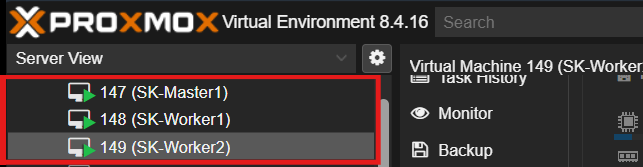
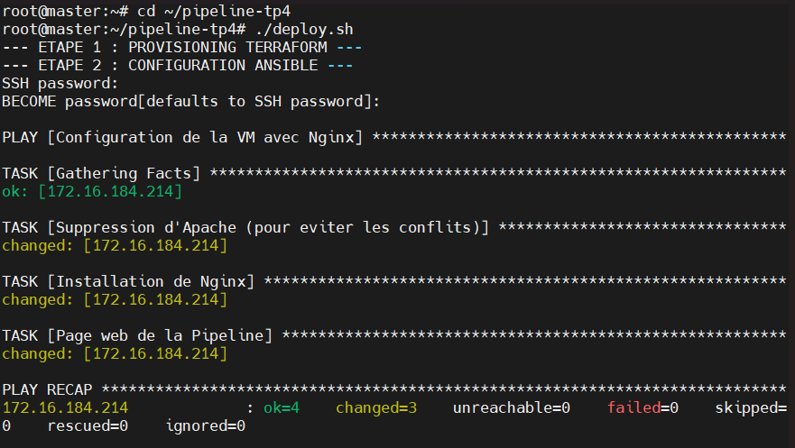

# Orchestration automatique — Cluster Kubernetes CI/CD

Conception et déploiement d'une chaîne complète d'automatisation d'infrastructure, du provisionnement des VM jusqu'au test de bout en bout, sur un cluster Kubernetes auto-hébergé.

**Stack :** Proxmox · Kubernetes v1.30 (containerd) · Terraform · Ansible · Jenkins · Gitea · Docker · Nginx

---

## Objectif

Déployer un cluster Kubernetes, y héberger une chaîne CI/CD (Gitea + Jenkins) et automatiser le provisionnement d'infrastructure via Terraform et Ansible — jusqu'au déploiement déclenché automatiquement à chaque `git push`.

## Architecture

| Nœud | Rôle | Dimensionnement |
|---|---|---|
| SK-Master1 | Control plane (etcd, API server) | 2 vCPU, 4 Go RAM |
| SK-Worker1 | Nœud de calcul | RAM adaptée à la JVM Jenkins |
| SK-Worker2 | Nœud de calcul | RAM adaptée à la JVM Jenkins |

Cluster de 3 nœuds virtualisés sur **Proxmox VE**, swap désactivé sur les 3 nœuds (prérequis Kubernetes). Outils CI/CD isolés dans un **namespace `ci-cd`** dédié (Gitea + Jenkins).

## Chaîne d'automatisation

1. **Terraform** — Infrastructure as Code sur Proxmox : création d'une VM et d'un conteneur, cycle de vie complet (`apply` / `destroy`).
2. **Ansible** — configuration automatisée : installation de Nginx, **idempotence du playbook vérifiée** (2ᵉ exécution = 0 changement).
3. **Jenkins (pipeline multibranche)** — déclenché automatiquement par webhook à chaque `git push` sur Gitea :

   `git push` → Terraform crée la VM → Ansible installe Nginx → Docker déploie le reverse proxy → **test `curl` de bout en bout**

## Livrables

- **[Documentation technique (PDF)](Doc-techniques/doc-projet-kubernetes.pdf)** — installation pas à pas du cluster, des outils CI/CD et des pipelines.
- **[Rapport final](Rapport-final/)** — bilan du projet.
- **[Captures](Screenchots/)** — cluster Proxmox, `kubectl get nodes`, Jenkins multibranche, pipeline, test e2e.

## Compétences démontrées

Déploiement d'un cluster Kubernetes multi-nœuds sur Proxmox · Infrastructure as Code (Terraform) · configuration automatisée et idempotente (Ansible) · CI/CD auto-hébergée (Gitea + Jenkins multibranche, webhooks) · conteneurisation (Docker) · chaîne de déploiement automatisée de bout en bout.

---

*Projet réalisé en autonomie — Styve Landry SIME KOUNOU — styvelandry1@outlook.fr — 2026*
